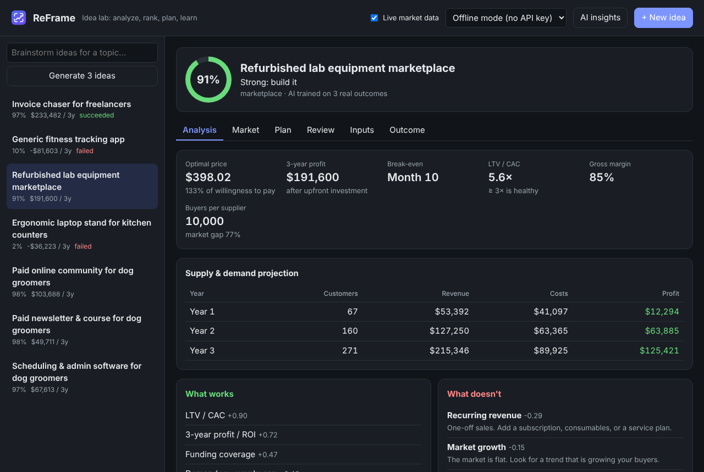
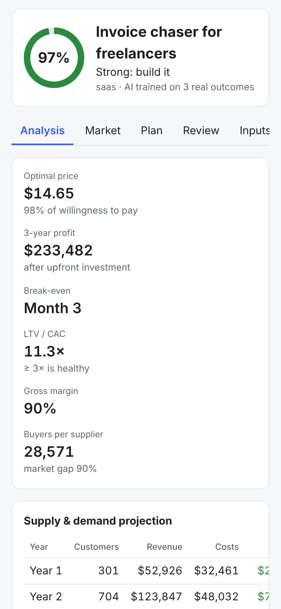

<div align="center">

<picture>
  <source media="(prefers-color-scheme: dark)" srcset="docs/assets/wordmark-dark.svg">
  
</picture>

### Turn ideas into ranked, profitable, step-by-step plans.

ReFrame scores your business ideas with a **supply & demand model** and a **self-learning AI**,
shows **what works and what doesn't**, checks them against **live market data**, and gives
you a **step-by-step plan with code** to build the best one. It runs **on your own PC**.

[](https://github.com/lucs-max/ReFrame/actions/workflows/tests.yml)


[**Quick start**](#quick-start) · [**Tutorials**](#tutorials) · [**Features**](#features) · [**How it works**](docs/how-it-works.md) · [**Commands**](docs/cli-reference.md)

<br>


</div>

## Quick start

You need [Python 3.9+](https://www.python.org/downloads/) (on Windows, tick **"Add Python to PATH"** when installing) and [Git](https://git-scm.com/downloads).

```bash
git clone https://github.com/lucs-max/ReFrame.git
cd ReFrame
pip install -e .
reframe demo        # load 4 example ideas
reframe serve       # opens the app in your browser
```

**On Windows** you can also just double-click **`Start ReFrame.bat`**. Keep the terminal
window open while you use the app.

New to the command line? Follow **[Tutorial 1: Install and start ReFrame](docs/tutorials/01-install.md)**.

## Features

<table>
<tr>
<td width="50%" valign="top">

### 📊 Supply & demand analysis
For every idea, ReFrame finds the **price that maximizes profit** and projects customers,
revenue, costs and profit over 3 years. You also get break-even, LTV/CAC, margins, and
how crowded the market is.

</td>
<td width="50%" valign="top">

### 🧠 An AI that explains itself and learns
A transparent model scores each idea and lists exactly **what pushes it up or down**.
Record real results and it **retrains on your history**.

</td>
</tr>
<tr>
<td valign="top">

### 🧪 What-if experiments
"What if I target a niche? Cut acquisition cost? Improve retention?" ReFrame re-runs
everything and ranks the changes by impact.

</td>
<td valign="top">

### 🗺️ Step-by-step plans with code
Validate → fix risks → build → launch → grow. Each step has a checklist and a clear
finish line, plus starter code for 8 kinds of business.

</td>
</tr>
<tr>
<td valign="top">

### 📡 Live market data
Wikipedia interest, Hacker News trends, App Store competitors and GitHub alternatives
**calibrate your numbers**. No API keys needed.

</td>
<td valign="top">

### 🔒 Runs on your PC
Works fully offline. Optional **local AI** (Ollama / LM Studio) writes ideas and reviews
on your own computer. Claude is optional, never required.

</td>
</tr>
</table>

## See it in action

| Step-by-step plan | Critical review |
|---|---|
|  |  |
| **Every step has why, a checklist, code and "done when".** | **Shows which guesses your profit depends on most.** |

| Live market data | What the AI has learned |
|---|---|
|  |  |
| **Live signals suggest updates to your numbers** *(example data)*. | **Retrains every time you record a real outcome.** |

<details>
<summary><b>More screenshots:</b> brainstorming, dark mode, phone</summary>
<br>

**Brainstorm ideas for a topic.** Offline mode works without any AI model.


**Dark mode** follows your system setting.


**Works on phones.**
<p></p>

</details>

## Tutorials

| | Tutorial | You'll learn to… |
|---|---|---|
| 1 | [Install and start ReFrame](docs/tutorials/01-install.md) | install on Windows, Mac or Linux and open the app |
| 2 | [Analyze your first idea](docs/tutorials/02-first-idea.md) | enter an idea, read the analysis, improve it with what-ifs |
| 3 | [Brainstorm ideas](docs/tutorials/03-brainstorm.md) | generate and rank ideas for any topic |
| 4 | [Follow the step-by-step plan](docs/tutorials/04-build-plan.md) | work through the plan and export it as a checklist |
| 5 | [Review and validate](docs/tutorials/05-review.md) | find which guesses matter most and check them first |
| 6 | [Use live market data](docs/tutorials/06-live-market.md) | calibrate ideas with real-time market signals |
| 7 | [Teach the AI](docs/tutorials/07-teach-the-ai.md) | record real results so the AI learns what works for you |
| 8 | [Run an AI model on your PC](docs/tutorials/08-local-ai.md) | set up Ollama or LM Studio for local AI |

## Three modes

ReFrame's scoring AI and planner **always run on your PC**. The mode only decides who writes
brainstormed ideas and reviews.

| | **Offline** (default) | **Local AI** | **Claude** |
|---|---|---|---|
| Needs | nothing | free [Ollama](https://ollama.com) or [LM Studio](https://lmstudio.ai) + a model | Anthropic API key with credit |
| Cost | free | free | paid per use |
| Your ideas leave your PC | no | no | yes |
| Switch with | `reframe mode offline` | `reframe mode local` | `reframe mode claude` |

You can also switch modes from the menu in the app's top bar.

## Command line

Everything in the app also works from the terminal:

```console
$ reframe rank
1. Invoice chaser for freelancers (#1) - 97%, 3y profit $233,482, Strong: build it
2. Refurbished lab equipment marketplace (#3) - 91%, 3y profit $191,600, Strong: build it
3. Generic fitness tracking app (#2) - 11%, 3y profit -$81,603, Unlikely to work as-is: pivot or drop
4. Ergonomic laptop stand for kitchen counters (#4) - 3%, 3y profit -$36,223, Unlikely to work as-is: pivot or drop
```

```bash
reframe analyze 1                    # full analysis
reframe plan 1 --out plan.md         # the plan as a Markdown checklist
reframe brainstorm "dog groomers"    # ideas for a topic
reframe market 1 --apply             # calibrate with live market data
reframe outcome 1 success            # teach the AI
```

See the **[command reference](docs/cli-reference.md)** for all commands.

## Troubleshooting

| Message | Cause and fix |
|---|---|
| "Failed to fetch" / "Can't reach ReFrame's server" | The server isn't running, or `index.html` was opened directly. Run `reframe serve` (or double-click `Start ReFrame.bat`) and reload. |
| `'reframe' is not recognized` | Activate your virtual environment, or use `python -m reframe` instead. |
| "Port 8765 is already in use" | ReFrame is already running: open http://127.0.0.1:8765, or use `reframe serve --port 8766`. |
| "ReFrame hit an unexpected error" | The details are in `.reframe/error.log` in your home folder. [Open an issue](https://github.com/lucs-max/ReFrame/issues) and attach it. |
| Live market sources "unavailable" | No internet, or blocked by a firewall/VPN. Everything else still works. Check with `reframe market --check`. |
| "No local AI found" | Install Ollama and run `ollama pull llama3.2`. See [Tutorial 8](docs/tutorials/08-local-ai.md). |

## Honest limits

ReFrame's numbers are only as good as its inputs. The model is a transparent
simplification, not a guarantee of profit. Live signals are indicators of supply and
demand, not sales data. Use ReFrame to **compare ideas, find the weak spots, and decide what
to validate next**, then replace guesses with real data from interviews, landing-page tests
and early sales. The more outcomes you record, the more the AI reflects what actually
works for you.

## Development

```bash
pip install -e ".[dev]"
pytest                               # the full test suite (no network needed)
python tools/gen_cli_reference.py    # regenerate docs/cli-reference.md
```

The code is plain Python with no dependencies; see the [code map](docs/how-it-works.md#9-code-map).
Tests run automatically on Windows, macOS and Linux for every push.
