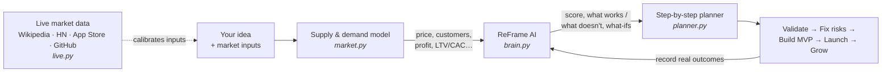

# How ReFrame works



Everything in this diagram runs on your PC. Only live market lookups use the internet,
and they send just your search keywords.

## 1. Supply & demand model (`reframe/market.py`)

The model is deliberately simple and transparent, so every number can be traced back to
an input.

- **Demand.** *Willingness to pay* is the **median** price buyers accept. The share of the
  market that buys at price *p* is `1 / (1 + (p / wtp)^(2 × elasticity))`: half the market
  at the median, dropping faster the more price-sensitive buyers are.
- **Supply.** Your fair share of the market is `pull / (competitors + 1)`, where `pull`
  grows with differentiation. A new entrant realistically wins **10%** of that fair share
  within three years.
- **Growth and adoption.** The market grows by *market growth* every year. Your adoption
  ramps 30% → 65% → 100% of the steady share over three years.
- **Retention.** Recurring businesses lose *yearly churn* of their customers each year, and
  every new customer costs the *acquisition cost*. One-off businesses re-acquire every buyer.
- **Pricing.** ReFrame tries 200 prices from your unit cost (at least 10% of willingness to pay) up to 3× willingness to pay,
  refines around the best one, and keeps the price with the **highest 3-year profit**.
- **Outputs.** Customers, revenue, costs and profit per year, total profit after the
  upfront investment, ROI, break-even month, gross margin, LTV, LTV/CAC, buyers per
  competitor (market gap), and the funding gap: money needed beyond your budget to
  survive the cash dip.

## 2. ReFrame AI (`reframe/brain.py`)

A logistic-regression model over 12 interpretable features, each scaled 0–1:

| Feature | Effect | Feature | Effect |
|---|---|---|---|
| Demand vs. supply gap | + | Time to break even | + |
| Market growth | + | Build complexity | − |
| Competition intensity (log scale) | − | Skill fit | + |
| Differentiation | + | Funding coverage | + |
| Gross margin | + | Recurring revenue | + |
| LTV / CAC | + | 3-year profit / ROI | + |

- **Priors.** The model starts from weights that encode common startup knowledge, with a
  negative base rate: most new projects fail, so an average idea scores below 50%.
- **Learning.** `reframe outcome` retrains on every recorded outcome by gradient descent on
  log-loss, with an L2 penalty **toward the priors** (not toward zero). A few outcomes
  nudge the weights; many outcomes let your history dominate.
- **Explanations.** Because the model is linear, each feature's contribution is exactly
  `weight × (value − 0.5)`. These are the *What works / What doesn't* lists.
- **What-if experiments** (`reframe/analyzer.py`) copy the idea, apply one change you control
  (sharper differentiation, cheaper acquisition, niche market, lower churn…), re-run the
  full analysis and rank the changes by impact.

## 3. Reviewer (`reframe/reviewer.py`)

Rule-based checks for risks, opportunities and unrealistic inputs, plus a **sensitivity
analysis**: each key input is made 20% worse, the market model is re-run, and inputs are
ranked by how much 3-year profit they put at risk. The top ones become the *questions to
validate first*.

## 4. Planner (`reframe/planner.py`)

Builds the phased plan from the idea's category and the analysis:

- Phase 1 (validation) uses the model's optimal price on a generated landing page.
- Phase 2 is assembled only from the risks the AI flagged.
- Phase 3 has category-specific build steps with starter code.
- Phases 4–5 use the projected numbers as launch and tracking targets.

## 5. Live market data and calibration (`reframe/live.py`)

| Source | Signal | Calibrates |
|---|---|---|
| Wikipedia page views (24 complete months) | median monthly views; this year vs. last year | market growth |
| Hacker News (Algolia API) | stories this year vs. last year | market growth |
| Apple App Store (iTunes Search API) | established apps (50+ ratings), median rating, paid-app prices | competitors, willingness to pay (apps), differentiation |
| GitHub search | repository count | competitors (software) |

**Calibration.** Each signal proposes a value for an input with a confidence between 0 and 1
based on how much data backs it (log of page views, number of stories, number of apps):

```
suggested = current + confidence × (signal − current)
```

Thin evidence nudges your number; strong evidence moves it most of the way.

**Consistency.** Fixed windows (complete months, whole days), medians instead of averages,
and a 12-hour on-disk cache mean repeat scans give identical results. A capped App Store
search (50 results) is a lower bound, so it never lowers your competitor count. A host that
fails is skipped for the rest of the run.

**Market pulse** averages growth, saturation (few established apps is good) and
competitor-rating headroom into a 0–1 score.

## 6. Modes (`reframe/templates.py`, `reframe/local_llm.py`, `reframe/llm.py`)

| | Offline (default) | Local AI | Claude |
|---|---|---|---|
| Brainstorm | 12 business-model templates; audience detection (business vs. consumer) adjusts which templates apply and their numbers; ranked by the AI | local model via Ollama or an OpenAI-compatible server; output validated and repaired | Claude API with structured outputs |
| Review | rule-based reviewer | local model + sensitivity analysis | Claude |
| Leaves your PC | nothing | nothing | the idea, sent to Anthropic |

Offline and local modes never load the Anthropic SDK. Claude mode needs `pip install -e ".[ai]"`,
a key (`reframe set-key`) and API credit. It uses the server-side refusal fallback
(`fallbacks: "default"`).

## 7. Market inputs

| Input | Meaning |
|---|---|
| `potential_customers` | people/businesses with the problem in your target market |
| `demand_growth` | yearly market growth (0.1 = 10%) |
| `willingness_to_pay` | median price per purchase buyers accept |
| `price_elasticity` | 0.5 = not price-sensitive … 3 = very price-sensitive |
| `purchases_per_year` | 12 for a monthly subscription, 1 for a one-off |
| `yearly_churn` | share of paying customers lost per year |
| `competitors` | direct alternatives buyers use today |
| `differentiation` | 0–1, how clearly better/different you are |
| `unit_cost` | variable cost per purchase |
| `customer_acquisition_cost` | cost to win one customer |
| `fixed_costs_per_year`, `upfront_investment`, `budget` | money in $ |
| `build_complexity`, `skill_fit` | 0–1 |

## 8. Where your data lives

Everything is stored in `~/.reframe` (or `$REFRAME_HOME`, or `--home`):

| File | Contents |
|---|---|
| `reframe.db` | ideas, outcomes, market scans, score history (SQLite) |
| `model.json` | the AI's learned weights |
| `config.json` | mode, live-data and local-AI settings |
| `market_cache.json` | cached live-market responses (12 hours) |
| `anthropic_api_key` | only if you saved one, readable by your user only |
| `error.log` | details of unexpected errors |

## 9. Code map

```
reframe/
├── models.py        Idea and MarketInputs
├── market.py        supply & demand model, price optimization
├── brain.py         the learning AI (features, priors, training, explanations)
├── analyzer.py      analysis + what-if experiments
├── reviewer.py      offline reviewer + sensitivity analysis
├── planner.py       step-by-step plans and starter code
├── templates.py     offline brainstorming
├── live.py          live market sources + calibration
├── local_llm.py     Ollama / LM Studio integration
├── llm.py           Claude integration (optional)
├── prompts.py       prompts shared by the AI integrations
├── engine.py        ties it all together (used by CLI and web)
├── storage.py       SQLite storage
├── cli.py           command line
├── web.py           web server + JSON API
└── static/index.html   the web app
```
