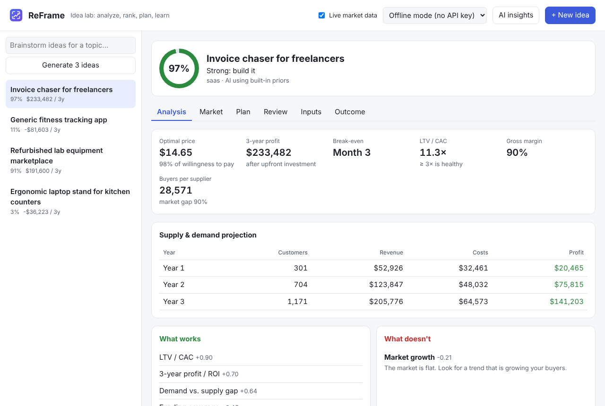

# Tutorial 1: Install and start ReFrame

**Time:** about 10 minutes · **You need:** a Windows, Mac or Linux computer

By the end you'll have ReFrame running in your browser with four example ideas loaded.

## Step 1: Install Python and Git

ReFrame is written in Python and has no other dependencies.

| | Windows | Mac | Linux |
|---|---|---|---|
| Python 3.9+ | [python.org/downloads](https://www.python.org/downloads/). In the installer, **tick "Add Python to PATH"**. | [python.org/downloads](https://www.python.org/downloads/), or `brew install python` | usually pre-installed: `python3 --version` |
| Git | [git-scm.com/downloads](https://git-scm.com/downloads) | `xcode-select --install` | `sudo apt install git` |

Check both work. Open a terminal (on Windows: **PowerShell**) and run:

```
python --version
git --version
```

> On Mac and Linux the command may be `python3` instead of `python`.

## Step 2: Download ReFrame

```
git clone https://github.com/lucs-max/ReFrame.git
cd ReFrame
```

> Prefer not to use Git? On the GitHub page click **Code → Download ZIP**, then unzip it.

## Step 3: Install it

A virtual environment keeps ReFrame separate from the rest of your system. It's optional
but recommended.

**Windows:**
```
python -m venv .venv
.venv\Scripts\activate
pip install -e .
```

**Mac / Linux:**
```
python3 -m venv .venv
source .venv/bin/activate
pip install -e .
```

Check it worked:

```
reframe --help
```

## Step 4: Start the web app

- **Windows:** double-click **`Start ReFrame.bat`** in the ReFrame folder.
- **Mac / Linux:** run `./start-reframe.sh` (or `reframe serve`).

Your browser opens **http://127.0.0.1:8765**.

> **Keep the black terminal window open** while you use ReFrame. Closing it stops the app,
> and the page will say *"Can't reach ReFrame's server"*.

## Step 5: Load the example ideas

In a second terminal (in the ReFrame folder, with the virtual environment activated):

```
reframe demo
```

```
Saved example #1: Invoice chaser for freelancers
Saved example #2: Generic fitness tracking app
Saved example #3: Refurbished lab equipment marketplace
Saved example #4: Ergonomic laptop stand for kitchen counters
```

Reload the browser page and click an idea:



You're ready. Next: **[Tutorial 2: Analyze your first idea →](02-first-idea.md)**

## If something goes wrong

| Problem | Fix |
|---|---|
| `'python' is not recognized` | Reinstall Python and tick **Add Python to PATH**. |
| `'reframe' is not recognized` | Activate the virtual environment again (Step 3), or use `python -m reframe` instead of `reframe`. |
| "Failed to fetch" in the browser | The server isn't running, or you opened `index.html` directly. Start it as in Step 4. |
| "Port 8765 is already in use" | ReFrame is already running: just open http://127.0.0.1:8765. |

More in the [troubleshooting table](../../README.md#troubleshooting).
