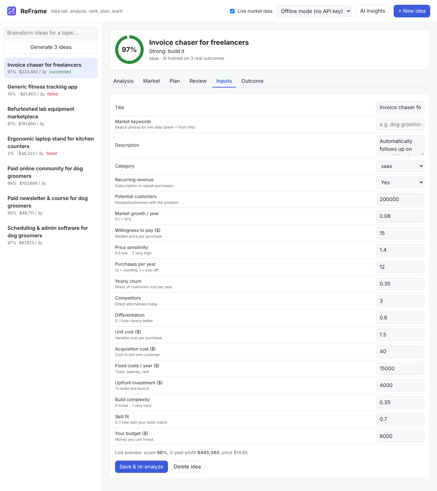
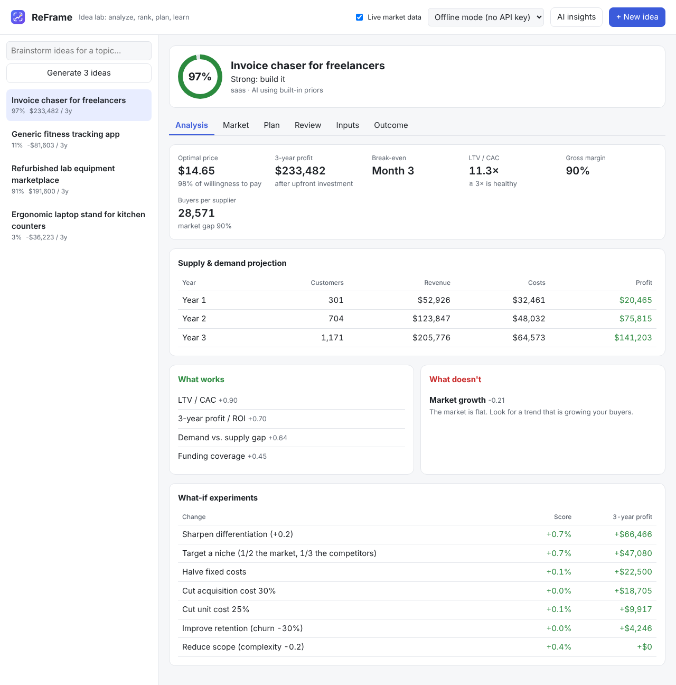

# Tutorial 2: Analyze your first idea

**Time:** about 15 minutes · **Before this:** [Tutorial 1](01-install.md)

You'll enter an idea, read ReFrame's analysis, and use what-if experiments to make the
idea stronger.

## Step 1: Create the idea

Click **+ New idea** in the top bar and fill in what you know. Every field has a neutral
default, so a rough guess is fine. You'll refine it later.

| Field | What to enter | Example (invoice reminders) |
|---|---|---|
| Potential customers | people or businesses who have the problem | 200,000 freelancers |
| Market growth / year | yearly growth (0.1 = 10%) | 0.08 |
| Willingness to pay | the price a *typical* buyer accepts, per purchase | $15 |
| Price sensitivity | 0.5 = they barely notice price … 3 = very price-sensitive | 1.4 |
| Purchases per year | 12 for a monthly subscription, 1 for a one-off | 12 |
| Yearly churn | share of paying customers lost per year | 0.35 |
| Competitors | alternatives buyers use today (count spreadsheets too) | 6 |
| Differentiation | 0–1, how clearly better you are | 0.6 |
| Unit cost | your cost each time someone buys | $1.50 |
| Acquisition cost | what it costs to win one customer (ads, sales time) | $40 |
| Fixed costs / year, upfront investment, budget | money in $ | 15,000 / 4,000 / 8,000 |
| Build complexity, skill fit | 0–1 | 0.35 / 0.7 |

Watch the **live preview** at the bottom of the form: the score and profit update as you type.



Click **Analyze & save**.

## Step 2: Read the analysis



From top to bottom:

1. **Success score and verdict.** ReFrame's AI rates how likely the idea is to work:
   *Strong* (70%+), *Promising* (50%+), *Weak* (35%+) or *Unlikely to work as-is*.
2. **Optimal price.** The supply-and-demand model tries every price and keeps the one with
   the highest 3-year profit. It's often a little *below* willingness to pay, because more
   buyers at a lower price can earn more in total.
3. **Key numbers:**
   - **Break-even:** the month your cash turns positive.
   - **LTV/CAC:** how much a customer is worth versus what they cost to win. Aim for 3× or more.
   - **Gross margin:** the share of each sale left after the unit cost.
   - **Buyers per supplier:** demand divided by the number of competitors. More is better.
4. **Supply & demand projection:** customers, revenue, costs and profit for each of the 3 years.
5. **What works / What doesn't:** the factors pushing the score up or down, each with advice.
6. **What-if experiments:** ReFrame re-runs the whole analysis with changes you control
   and shows the effect on the score and on profit.

## Step 3: Improve the idea with what-ifs

Pick the experiment with the biggest effect and ask yourself whether you can really do it.
For example, *"Target a niche (1/2 the market, 1/3 the competitors)"*: could you focus on
freelance designers instead of all freelancers?

If so, open the **Inputs** tab, change the numbers (for example competitors 6 → 2,
customers 200,000 → 100,000) and click **Save & re-analyze**.

## Step 4: Compare ideas

The list on the left shows every idea's score and 3-year profit. On the command line:

```
reframe rank
```

```
1. Invoice chaser for freelancers (#1) - 97%, 3y profit $233,482, Strong: build it
2. Refurbished lab equipment marketplace (#3) - 91%, 3y profit $191,600, Strong: build it
3. Generic fitness tracking app (#2) - 11%, 3y profit -$81,603, Unlikely to work as-is: pivot or drop
4. Ergonomic laptop stand for kitchen counters (#4) - 3%, 3y profit -$36,223, Unlikely to work as-is: pivot or drop
```

## The same on the command line

```
reframe new "Invoice chaser for freelancers"   # asks for each input
reframe analyze 1
reframe edit 1 --set competitors=2 --set potential_customers=100000
```

> **Remember:** the analysis is only as good as your inputs. Treat the first numbers as
> guesses, then replace them with what you learn from customers ([Tutorial 5](05-review.md))
> and live market data ([Tutorial 6](06-live-market.md)).

Next: **[Tutorial 3: Brainstorm ideas →](03-brainstorm.md)**
