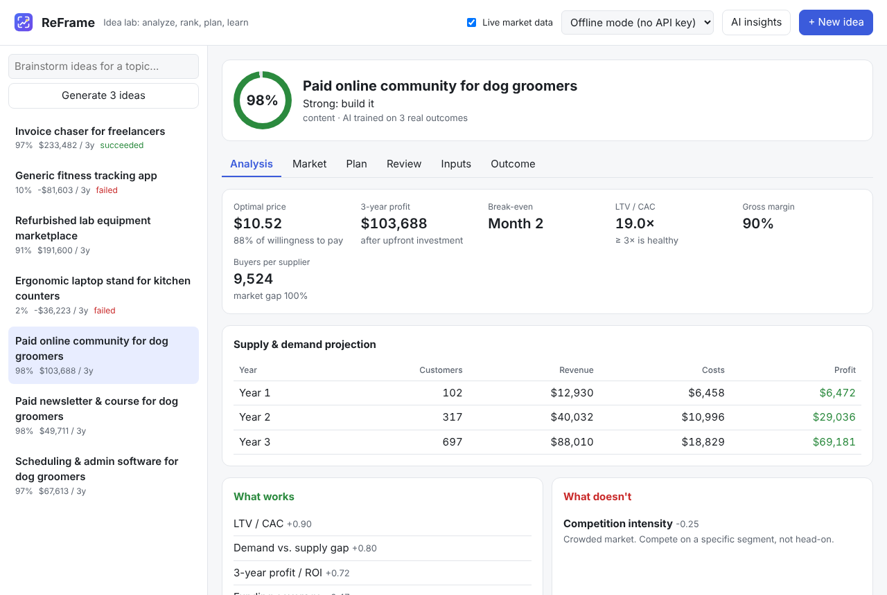

# Tutorial 3: Brainstorm ideas for a topic

**Time:** 5 minutes · **Before this:** [Tutorial 2](02-first-idea.md)

No idea yet? Give ReFrame a topic and it suggests ideas, then scores and ranks them.

## Step 1: Pick a mode

The menu in the top bar decides **who writes the ideas**. Scoring and plans always run on
your PC.

| Mode | Who writes the ideas | Needs |
|---|---|---|
| **Offline mode** (default) | built-in business-model templates matched to your topic | nothing |
| **Local AI (on this PC)** | a language model running on your computer | Ollama or LM Studio ([Tutorial 8](08-local-ai.md)) |
| **Claude mode** | Claude in the cloud | an Anthropic API key with credit |

## Step 2: Brainstorm

Type a topic in the box at the top left, such as **dog groomers**, **small restaurants** or
**college students**, and click **Generate 3 ideas**.



In offline mode, ReFrame works out whether the topic is about **businesses** (restaurants,
clinics, groomers…) or **consumers** (students, pet owners, gamers…). It picks business
models that fit, such as software, a service, a community or a subscription box, and
keeps the ones its AI rates highest.

With **Live market data** switched on (top bar), each idea's numbers are also adjusted
with real market signals ([Tutorial 6](06-live-market.md)).

## Step 3: Make the numbers yours

Brainstormed numbers are **starting guesses** for that kind of business, not research about
your exact topic. Open the idea's **Inputs** tab and correct anything you know better.
The score updates as you type.

## The same on the command line

```
reframe brainstorm "dog groomers" --count 5 --save
```

```
Offline mode: ideas come from business-model templates matched to your topic.
The market numbers are starting guesses: replace them with real data using
`reframe edit <id> --set field=value` (add --save to keep the ideas).

=== Paid online community for dog groomers  (#5, content) ===
Success score  ███████████████████░ 94%   => Strong: build it
...
```

Next: **[Tutorial 4: Follow the step-by-step plan →](04-build-plan.md)**
