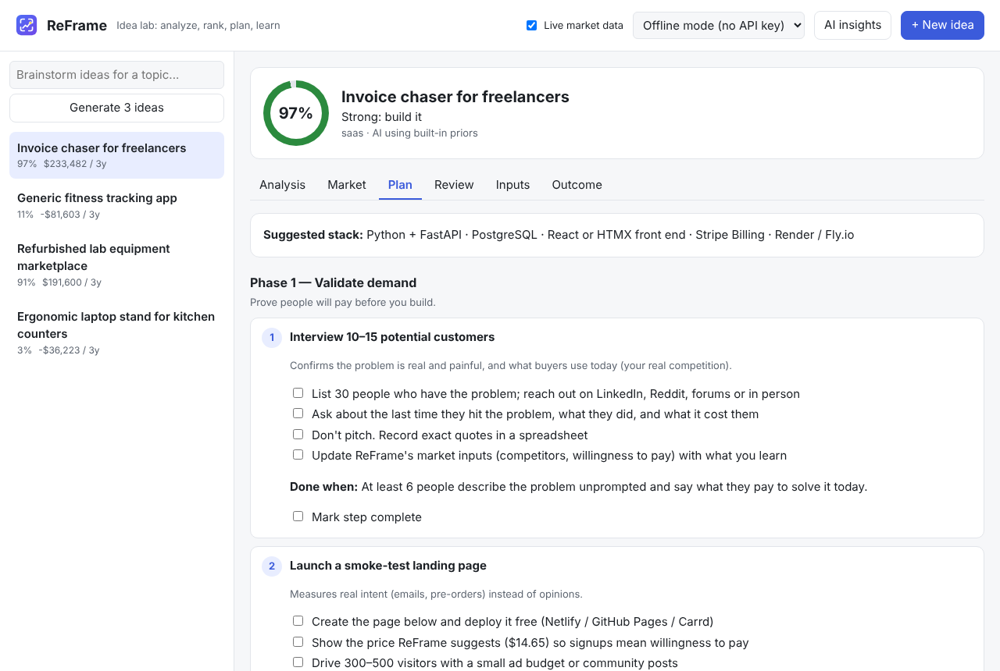

# Tutorial 4: Follow the step-by-step build plan

**Time:** 10 minutes to read; the plan itself takes weeks · **Before this:** [Tutorial 2](02-first-idea.md)

Every idea gets a plan that shows **what to do, why, how, and when each step is done**,
including real commands and starter code.

## Step 1: Open the plan

Click an idea, then the **Plan** tab.



The plan has up to five phases:

| Phase | What happens |
|---|---|
| **1. Validate demand** | customer interviews and a ready-made landing page to test whether people will pay |
| **2. Fix the biggest risks** | only appears if the AI found risks; each step targets one (e.g. *Pick a beachhead niche*, *Fix unit economics*) |
| **3. Build the MVP** | concrete build steps for the idea's category, with commands and starter code |
| **4. Launch** | launch at the price ReFrame calculated |
| **5. Measure & grow** | track the real numbers against the projection, and teach the AI |

## Step 2: Work through the steps

Each step has:

- **Why:** the reason it matters.
- **A checklist:** tick items off as you go (ReFrame remembers your ticks in this browser).
- **Code** where useful, with a **Copy** button: a landing page, a FastAPI backend, an Expo
  mobile app, Stripe checkout, a marketplace database schema, API-key metering…
- **Done when:** a clear, measurable finish line. Tick **Mark step complete** when you reach it.

The Build phase depends on the idea's category:

| Category | Build steps include |
|---|---|
| `saas` | FastAPI backend, database + accounts, the one core screen, payments, deploy |
| `api` | API scaffold, API keys + usage metering, docs/quickstart, metered billing |
| `mobile_app` | Expo app on your phone, Supabase accounts, in-app purchases, store submission |
| `marketplace` | manual "concierge" MVP first, data model, Stripe Connect payouts, trust features |
| `ecommerce` | sourcing samples, Shopify store, email flows |
| `physical_product` | prototype, design for manufacturing, pre-sales, logistics |
| `content` | publish 10 pieces, email list, paid tier |
| `service` | package the offer, business basics, first 3 clients |

> **Don't skip Phase 1.** If interviews or the landing page show weak demand, go back to the
> Inputs tab, update the numbers, and let ReFrame re-score the idea before you build.

## Step 3: Take the plan with you

Save it as a Markdown checklist that opens in Notion, Obsidian, GitHub, VS Code and others:

```
reframe plan 1 --out plan.md
```

```
# Build plan: Invoice chaser for freelancers

**Category:** saas
**Suggested stack:** Python + FastAPI, PostgreSQL, React or HTMX front end, Stripe Billing, Render / Fly.io
**ReFrame success score:** 97% (Strong: build it)

## Phase 1 — Validate demand
_Prove people will pay before you build._

### Step 1: Interview 10–15 potential customers
- [ ] List 30 people who have the problem; reach out on LinkedIn, Reddit, forums or in person
...
```

Next: **[Tutorial 5: Get a review and validate →](05-review.md)**
