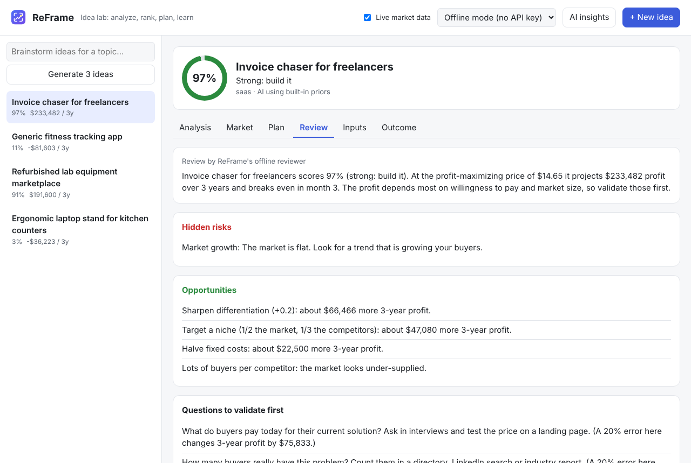

# Tutorial 5: Get a review and find what to validate first

**Time:** 5 minutes · **Before this:** [Tutorial 2](02-first-idea.md)

The **Review** tab is a critical second opinion. Most usefully, it tells you **which of your
guesses the profit depends on most**, so you know what to check first.

## Step 1: Open the review

Click an idea, then the **Review** tab.



| Section | What it tells you |
|---|---|
| **Summary** | the verdict and key numbers in one paragraph |
| **Hidden risks** | problems the numbers point to (thin margins, long break-even, high churn…) |
| **Opportunities** | changes worth making, with their profit impact |
| **Questions to validate first** | what to ask customers, ranked by how much it matters |
| **Inputs to double-check** | numbers that look unrealistic (zero competitors, very low acquisition cost…) |
| **What your profit depends on most** | profit lost if each input turns out 20% worse than you entered |

## Step 2: Validate the top inputs

Look at the top of **What your profit depends on most**. If *Willingness to pay* is first,
a 20% mistake there costs more than anything else, so confirm it first:

- Ask interviewees what they pay today for their current solution.
- Show your price on the landing page from Plan step 2 and measure sign-ups.

Then update the input in the **Inputs** tab. The score, plan and review all update.

## Who writes the review?

| Mode | Review by |
|---|---|
| Offline | ReFrame's rule-based reviewer (instant) |
| Local AI | your local model's critique, plus the same sensitivity table |
| Claude | Claude's critique |

## On the command line

```
reframe review 1
```

Next: **[Tutorial 6: Use live market data →](06-live-market.md)**
