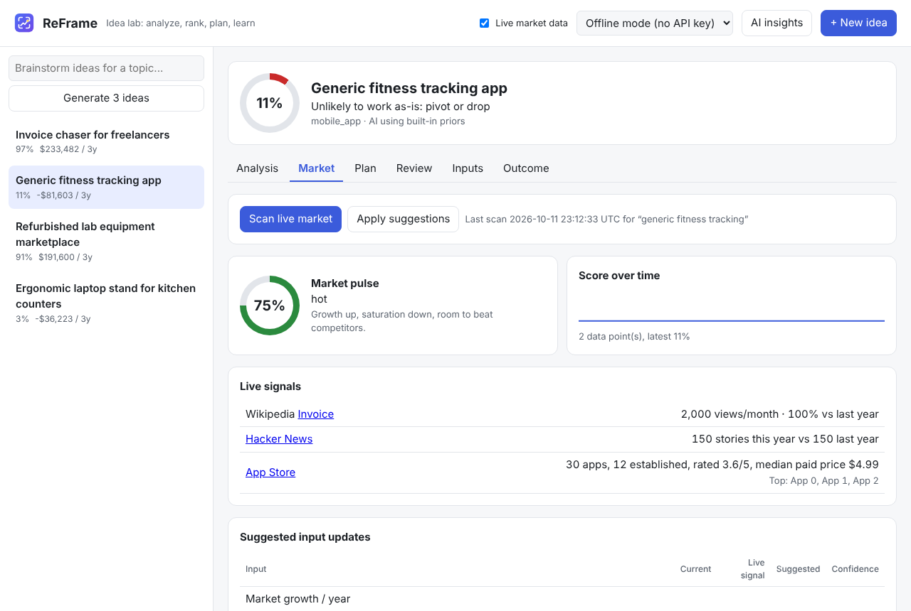

# Tutorial 6: Calibrate ideas with live market data

**Time:** 5 minutes · **You need:** internet (no accounts or API keys)

ReFrame can check your guesses against **what's happening in the market right now**, using
free public sources.

| Source | What it measures | Inputs it adjusts |
|---|---|---|
| Wikipedia page views (last 24 months) | interest in the topic, and whether it's growing | market growth |
| Hacker News | whether discussion is rising (strongest for tech topics) | market growth |
| Apple App Store | established competitors, their ratings and prices | competitors, willingness to pay (apps), differentiation room |
| GitHub | open-source alternatives | competitors (software ideas) |

## Step 1: Check the sources work from your PC

```
reframe market --check
```

Each source should say `ok`. If one says *can't reach*, your internet, firewall or VPN is
blocking it. Everything else in ReFrame still works.

## Step 2: Set the search keywords

Live data searches for the idea's **Market keywords** (Inputs tab). If it's blank, ReFrame
uses the main words of the title. Short phrases work best: `dog grooming`, `invoice`,
`meal planning`.

## Step 3: Scan

Open an idea, click the **Market** tab, then **Scan live market**.


*The numbers in this screenshot are example data.*

- **Market pulse:** a 0–100% summary: *hot*, *healthy*, *cooling* or *cold or saturated*.
- **Live signals:** what each source found, with links.
- **Suggested input updates:** your current number, what the live signal says, the
  suggestion, and how confident ReFrame is.

## Step 4: Apply

Click **Apply suggestions**. ReFrame updates the inputs and re-scores the idea.

**Why suggestions don't just copy the live number:** each suggestion moves your number
*part of the way*, more when the evidence is strong (lots of page views, many apps) and
less when it's thin. Your own knowledge still counts, and one noisy reading can't swing
the result. Repeat scans within 12 hours give identical answers.

## Step 5: Track the market over time

Every scan records the idea's score. The **Score over time** chart shows how the market is
moving it. To re-scan automatically:

```
reframe watch --every 6           # every 6 hours, while the window is open
reframe watch --once --apply      # one pass: schedule it with Windows Task Scheduler or cron
reframe history 1                 # score history on the command line
```

## Privacy and switching it off

Only your **keywords** are sent (to Wikipedia, Hacker News/Algolia, Apple and GitHub),
never your numbers. Untick **Live market data** in the top bar, or run `reframe live off`,
to stop all lookups.

> These signals are indicators of supply and demand, not sales data. They make your
> numbers more grounded and comparable. Real customer conversations still matter most.

Next: **[Tutorial 7: Teach the AI with real results →](07-teach-the-ai.md)**
