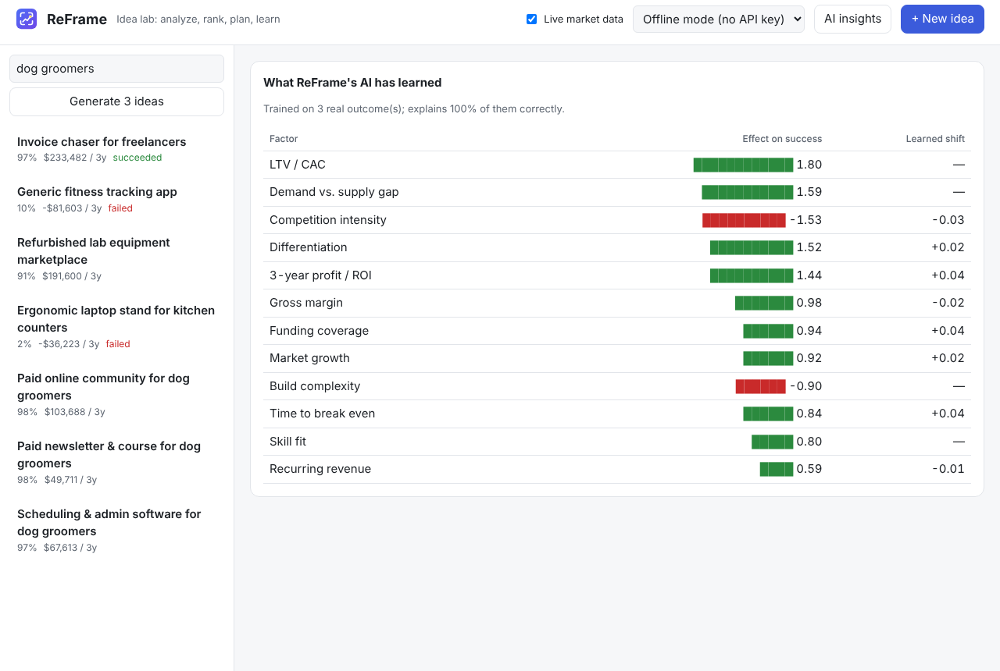

# Tutorial 7: Teach the AI with real results

**Time:** 2 minutes per idea · **When:** once a launched idea clearly succeeded or failed

ReFrame's AI starts with built-in knowledge about what usually works. Every real result you
record **retrains it on your own history**, so over time it learns what works *for you*.

## Step 1: Record what happened

Open the idea, click the **Outcome** tab, optionally enter the actual profit and a note,
then click **It succeeded** or **It failed**.

```
reframe outcome 1 success --profit 40000
reframe outcome 4 failure --notes "nobody paid after the free trial"
```

```
Recorded. The AI retrained on 2 outcome(s); it now explains 100% of them correctly.
```

## Step 2: See what it learned

Click **AI insights** in the top bar.


*Example after recording three outcomes.*

- **Effect on success:** how strongly each factor pushes ideas up (green) or down (red).
- **Learned shift:** how much your real results changed the AI's original belief.

## How the learning works

The AI is a transparent model with 12 factors: market gap, growth, competition,
differentiation, margin, LTV/CAC, profit, time to break even, complexity, skill fit,
funding and recurring revenue.

- It retrains on **all** your recorded outcomes each time you add one.
- It's held close to its starting knowledge, so two or three results can't make it
  overconfident. The more outcomes you record, the more it trusts your history.
- Every score can be explained exactly: the **What works / What doesn't** lists are each
  factor's precise contribution.

Next: **[Tutorial 8: Run an AI model on your own PC →](08-local-ai.md)**
