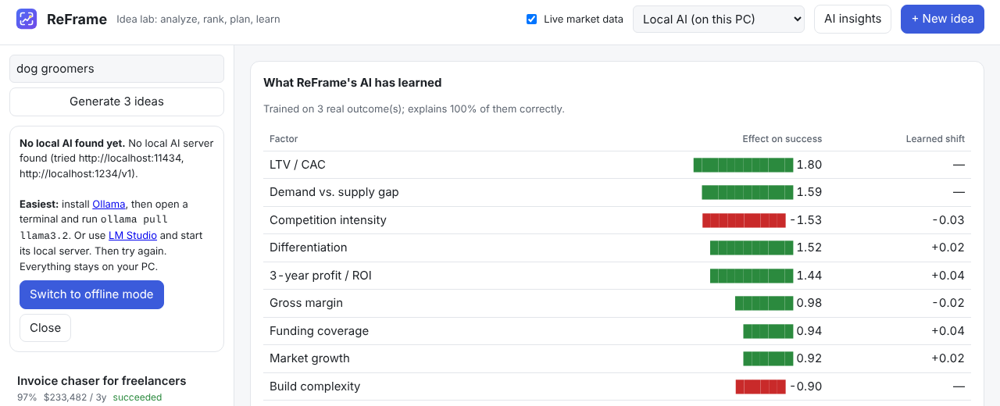

# Tutorial 8: Run an AI model on your own PC

**Time:** 15 minutes (mostly downloading) · **Cost:** free · **Your ideas never leave your computer**

In **Local AI** mode, brainstorming and reviews are written by a language model running on
your PC instead of built-in templates. You need one free app: **Ollama** (easiest) or
**LM Studio**.

## Which model should I use?

| Your PC | Model | Download | Command |
|---|---|---|---|
| Most laptops (8 GB RAM) | Llama 3.2 3B | ~2 GB | `ollama pull llama3.2` |
| 16 GB+ RAM or a graphics card | Qwen 2.5 7B | ~5 GB | `ollama pull qwen2.5:7b` |
| Powerful PC with a good graphics card | Llama 3.1 8B or larger | 5 GB+ | `ollama pull llama3.1:8b` |

Bigger models give noticeably better ideas, but they're slower. Without a graphics card,
a brainstorm can take a minute or two.

## Option A: Ollama (recommended)

1. Download and install Ollama from **[ollama.com](https://ollama.com)**. It runs in the
   background (look for the llama icon near the clock).
2. Open a terminal and download a model:
   ```
   ollama pull llama3.2
   ```
3. Tell ReFrame to use it:
   ```
   reframe mode local
   reframe local
   ```
   ```
   Ready: Using Ollama at http://localhost:11434 with model llama3.2:latest
   ```

## Option B: LM Studio

1. Install **[LM Studio](https://lmstudio.ai)** and download a model from its search page
   (for example *Qwen2.5 7B Instruct*).
2. Open the **Developer** tab, load the model and click **Start Server**.
3. Run `reframe mode local`. ReFrame finds it automatically at `localhost:1234`.

## Use it

In the web app, choose **Local AI (on this PC)** from the mode menu, type a topic and click
**Generate 3 ideas**. The **Review** tab now shows your local model's critique.

If ReFrame can't find a local AI, it shows these setup steps:



## Settings

```
reframe local                          # status and installed models
reframe local --model qwen2.5:7b       # pick a model (default: picks one automatically)
reframe local --provider openai --url http://localhost:8080/v1   # llama.cpp, Jan, LocalAI…
```

## Why the answers are reliable

Small models sometimes make formatting slips. ReFrame checks every answer and fixes common
problems: extra text around the data, "15" meaning 15%, unknown categories, and numbers
outside sensible ranges. If a reply is unusable, it asks once more.

## Back to offline

Choose **Offline mode** in the menu, or run `reframe mode offline`.

---

**You've finished the tutorials.** See the [command reference](../cli-reference.md) for every
command, or [how it works](../how-it-works.md) for the details of the model.
